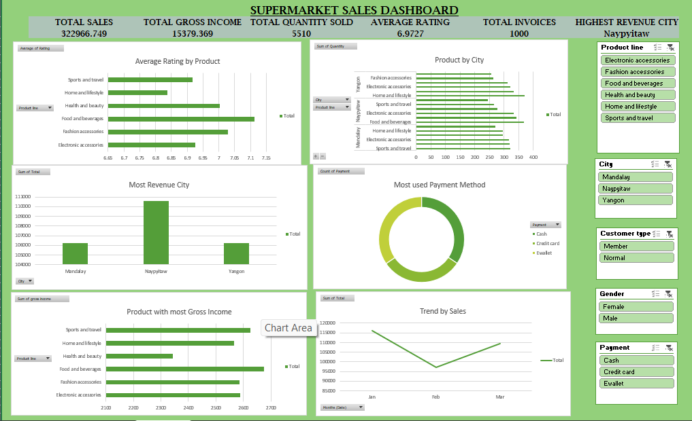

# Supermarket Sales Analysis & Dashboard

## 📊 Project Overview

An interactive Supermarket Sales Dashboard developed using Microsoft Excel to analyze sales performance, gross income, product performance, customer characteristics, payment methods, and sales trends.

## 🛠️ Tools Used

- Microsoft Excel
- Pivot Tables
- Pivot Charts
- Slicers
- Data Analysis
- Data Visualization

## 📌 Key KPIs

| KPI | Value |
|---|---:|
| Total Sales | 329,926.749 |
| Total Gross Income | 15,379.369 |
| Total Quantity Sold | 5,510 |
| Average Rating | 6.9727 |
| Total Invoices | 1,000 |
| Highest Revenue City | Naypyitaw |

## 📈 Dashboard Analysis

The dashboard provides analysis of:

- Average Rating by Product
- Product Sales by City
- Revenue by City
- Payment Method Usage
- Gross Income by Product
- Monthly Sales Trends

## 🎛️ Interactive Filters

The dashboard includes slicers for:

- Product Line
- City
- Customer Type
- Gender
- Payment Method

## 💡 Key Insights

- Naypyitaw generated the highest revenue among the three cities.
- Product-level sales performance can be compared across different cities.
- Gross income can be analyzed across different product lines.
- Payment preferences can be analyzed using the payment-method chart.
- Monthly sales trends provide an overview of sales performance over time.

## 📷 Dashboard Preview

## 👩‍💻 Skills Demonstrated

- Microsoft Excel
- Data Cleaning
- Data Analysis
- Pivot Tables
- Pivot Charts
- Dashboard Development
- Data Visualization
- KPI Analysis
- Business Insights
